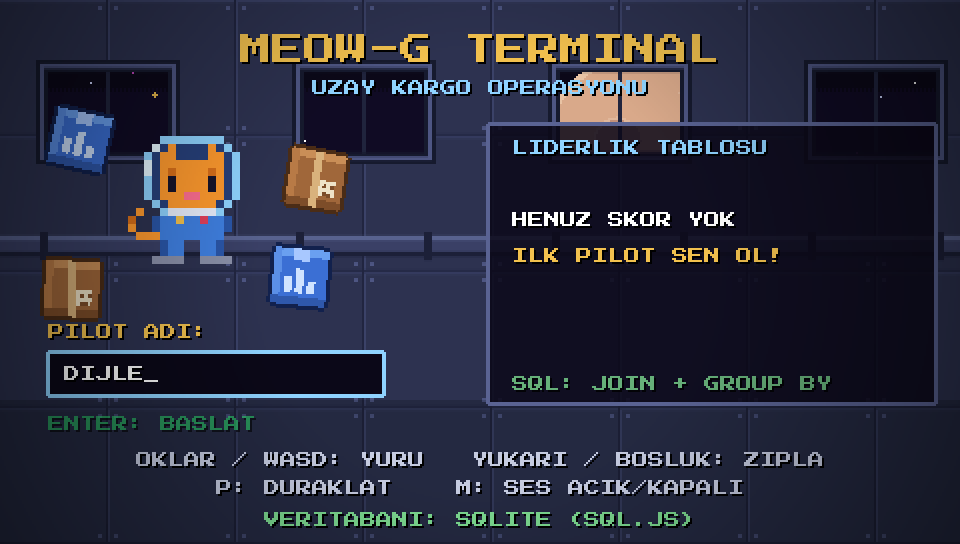
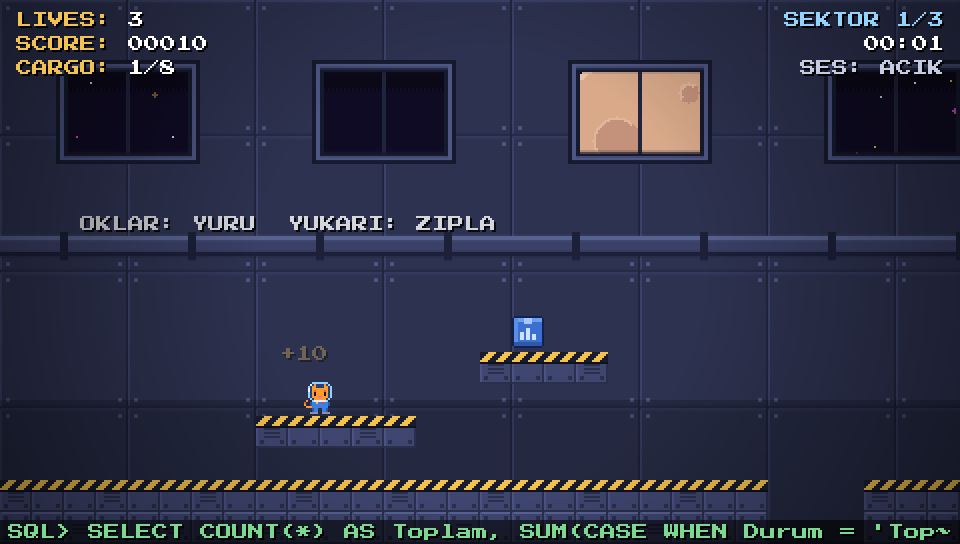
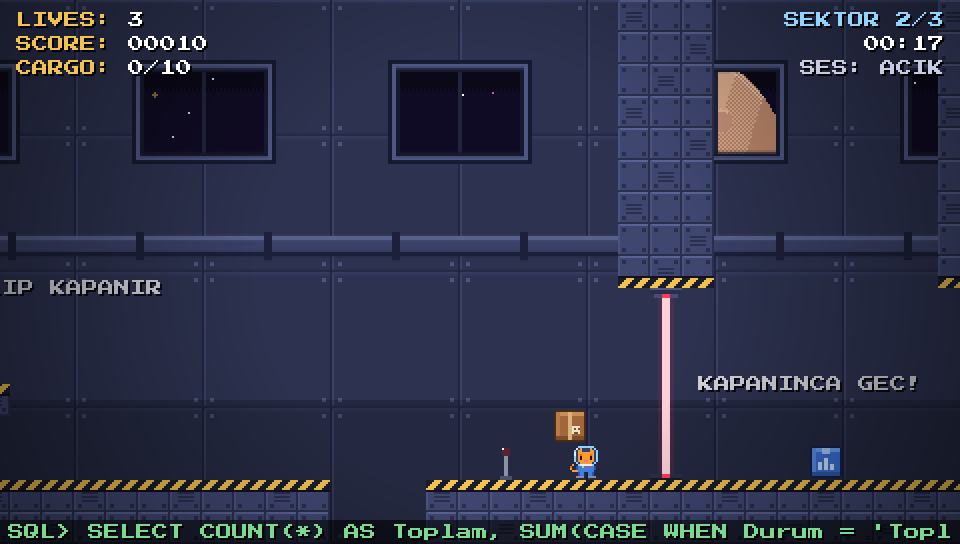
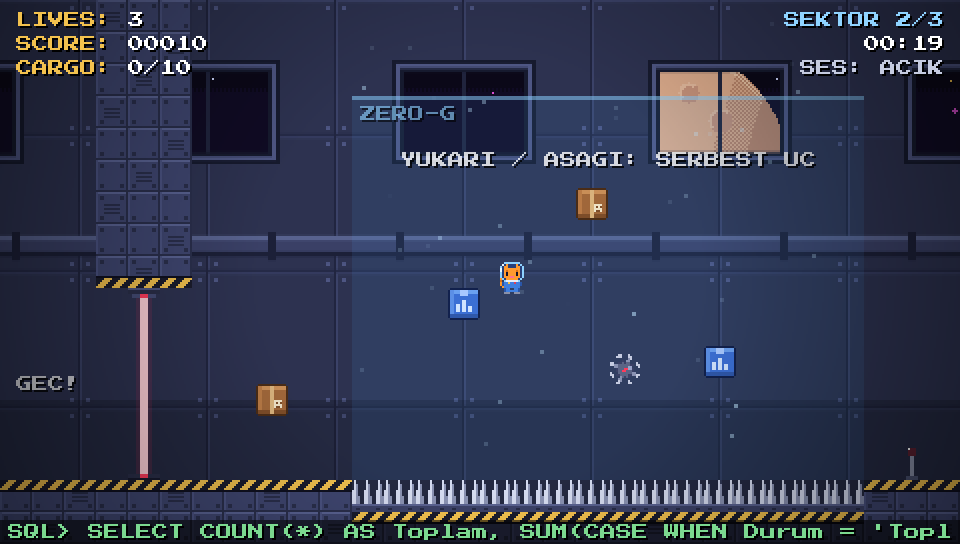
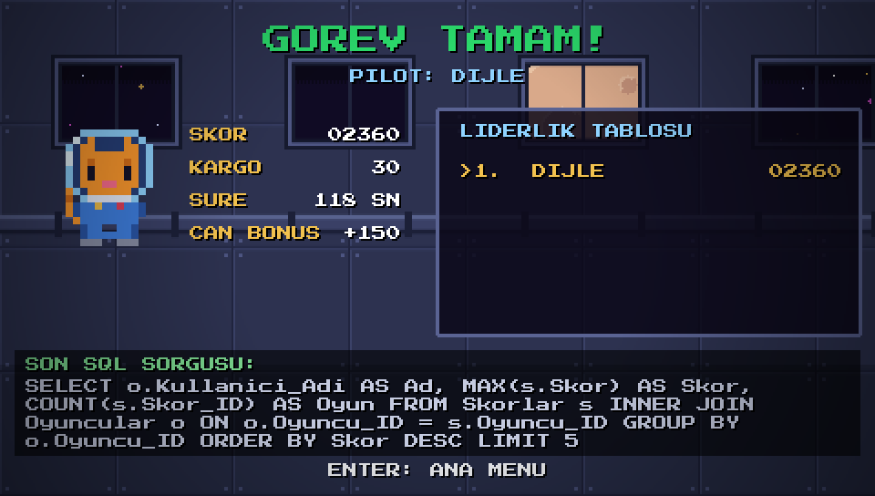

# MEOW-G TERMINAL
🎮 OYUNU TARAYICIDA HEMEN OYNAMAK İÇİN BURAYA TIKLAYIN (https://dijledogan.github.io/meow-g-terminal/)

Uzay istasyonunda geçen, tarayıcıda oynanan **piksel platform oyunu**. Yerçekimi jeneratörleri bozulmuş. Astronot kedi, havada süzülen kargo kutularını toplayıp çıkış kapısına ulaşmaya çalışıyor. Lazer kapıları, dikenler ve mayınlar yolunu kesiyor.

Oyunun arka planında **gerçek bir SQLite veritabanı** (sql.js) çalışır: kargolar, oyuncular ve skorlar SQL ile tutulur. Oyun sırasında ekranın altında çalışan SQL sorguları canlı olarak görünür.







## Nasıl oynanır

`index.html` dosyasını tarayıcıda açın (çift tıklamak yeterli, kurulum yok). Phaser ve sql.js kütüphaneleri internetten yüklendiği için bağlantı gerekir.

| Tuş | İş |
|---|---|
| Ok tuşları / A D | Yürü |
| Yukarı / W / Boşluk | Zıpla (tuşu bırakırsan daha kısa zıplar) |
| Zero-G alanında yukarı / aşağı | Havada serbest uç |
| P | Duraklat |
| M | Sesi aç / kapat |

**Amaç:** Her sektördeki bütün kargo kutularını topla, kapı açılınca çıkışa gir. Hızlı bitirirsen süre bonusu, bölüm geçince ekstra can kazanırsın. 3 sektör vardır.

| Öğe | Ne yapar |
|---|---|
| Mavi kutu | 10 puan, 5 kg |
| Kahverengi kutu | 25 puan, 8 kg |
| Dikenler, mayınlar | 1 can götürür |
| Lazer kapısı | Açılıp kapanır, kapanmadan önce kırmızı yanıp söner |
| Zero-G alanı (mavi bölge) | Yerçekimi kapanır, yukarı / aşağı serbest uçarsın |
| Yeşil lamba | Kayıt noktası (düşersen buradan devam edersin) |

## Kullanılan SQL konuları

Veritabanı kodu: [`js/db.js`](js/db.js)

| SQL konusu | Oyunda nerede kullanılıyor |
|---|---|
| `CREATE TABLE`, `PRIMARY KEY`, `AUTOINCREMENT` | Oyuncular, Bolumler, Kargolar, Skorlar tablolarının kurulumu |
| `FOREIGN KEY` | Kargolar → Bolumler, Skorlar → Oyuncular ilişkisi |
| `NOT NULL`, `UNIQUE`, `DEFAULT`, `CHECK` | Kullanıcı adı tekil, kargo türü ve durumu kısıtlı |
| `INSERT INTO` | Bölüm ve kargo verisi, oyuncu kaydı, skor kaydı |
| `UPDATE` ... `WHERE` | Kutu toplanınca `Durum = 'Toplandi'`, yeni oyunda sıfırlama |
| `SELECT` ... `WHERE` | Oyuncunun kaydını bulma |
| `COUNT`, `SUM`, `CASE` | Bölümde kaç kargo toplandı, toplanan toplam ağırlık |
| `INNER JOIN` | Skorlar tablosunu oyuncu adlarıyla birleştirme |
| `GROUP BY`, `MAX()` | Oyuncu başına en yüksek skor |
| `ORDER BY`, `LIMIT` | Liderlik tablosunda ilk 5 |
| `IFNULL`, `INSERT OR IGNORE` | Boş değer ve tekrar eden oyuncu adı yönetimi |

### Veritabanı şeması

```
Oyuncular (Oyuncu_ID PK, Kullanici_Adi UNIQUE, Kayit_Tarihi)
Bolumler  (Bolum_ID PK, Bolum_Adi, Hedef_Kargo)
Kargolar  (Kargo_ID PK, Bolum_ID FK, Tur, Agirlik, Puan, Durum)
Skorlar   (Skor_ID PK, Oyuncu_ID FK, Skor, Toplanan_Kargo, Sure_Sn, Tarih)
```

Veritabanı tarayıcının `localStorage` alanına kaydedilir, sayfa yenilense de skorlar kalır. sql.js yüklenemezse oyun bozulmasın diye aynı işi gören bir yedek mod devreye girer; menüde hangi modda çalışıldığı yazar.

## Proje yapısı

```
index.html        Sayfa ve kütüphane yüklemeleri
css/style.css     Sayfa çerçevesi, gömülü piksel font
js/levels.js      3 bölümün tasarımı (platformlar, kutular, tehlikeler)
js/db.js          SQLite veritabanı katmanı (tüm SQL burada)
js/art.js         Tüm grafikler kodla çizilir (kedi, kutular, duvar, ay...)
js/audio.js       8-bit ses efektleri ve müzik (Web Audio, ses dosyası yok)
js/scenes.js      Menü, oyun, sonuç sahneleri
js/main.js        Oyunu başlatır
build.py          Tüm dosyaları tek HTML'de birleştirir (dist/)
```

Tek dosyalık sürüm için: `python build.py` → `dist/meow-g-terminal.html`

## Teknolojiler ve kaynaklar

- [Phaser 3](https://phaser.io) (MIT) 2D oyun motoru ve fizik
- [sql.js](https://github.com/sql-js/sql.js) (MIT) tarayıcıda çalışan SQLite
- [Press Start 2P](https://fonts.google.com/specimen/Press+Start+2P) fontu (SIL Open Font License), CodeMan38
- Tüm piksel grafikler ve sesler kodla üretilmiştir, harici görsel veya ses dosyası kullanılmamıştır.

## Geliştirme notu

Bu proje, staj kapsamında modern yazılım geliştirme pratikleri uygulanarak hayata geçirilmiştir. Oyun mimarisi, SQL veritabanı şeması ve sistem tasarımı tamamen özgün olarak kurgulanmış; kodlama ve hata ayıklama (debugging) aşamalarında ise modern yapay zeka araçları (LLM) ile pair-programming (eşli programlama) tekniği kullanılarak iteratif bir süreç izlenmiştir.
